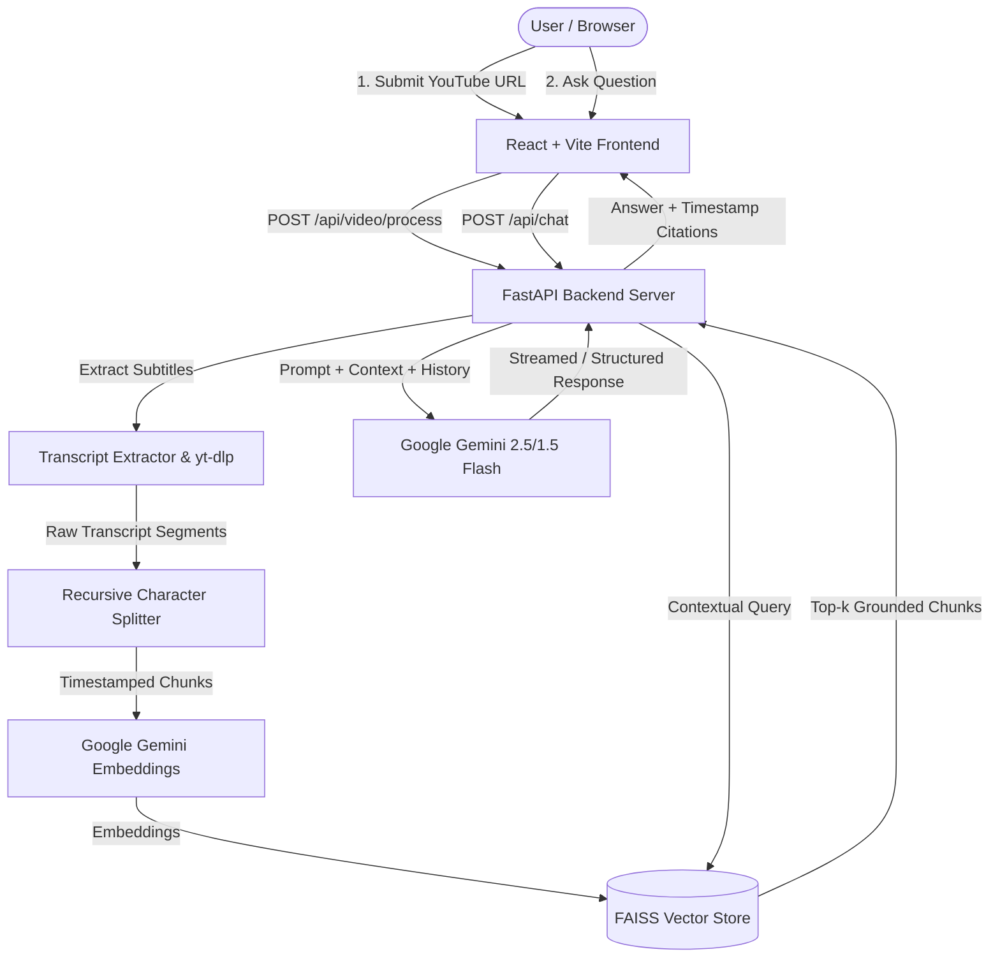

# 🎥 YouTube RAG Chatbot

<p align="center">
  <strong>Transform any YouTube video into an interactive, conversational AI knowledge base with grounded answers and clickable timestamp citations.</strong>
</p>

<p align="center">
  
  
  
  
  
  
  
</p>

---

## 🌟 Overview

**YouTube RAG Chatbot** is a production-ready, full-stack Retrieval-Augmented Generation (RAG) system built with **FastAPI**, **LangChain**, **Google Gemini**, **FAISS**, and **React**. 

Paste any YouTube video URL, and the platform automatically extracts transcripts, chunks content with timestamps, generates dense vector embeddings, and allows you to ask contextual, conversational questions. Every answer is strictly grounded in the video transcript and features clickable video timestamp citations so you can verify answers at the exact second in the video.

---

## ✨ Key Features

- 🎯 **Strict Single-Video Isolation**: Uploading a new video immediately resets prior chat history and rebuilds an isolated vector index. Answers are guaranteed to be sourced solely from the currently active video.
- ⏱️ **Clickable Timestamp Citations**: Every generated response includes precise citation badges with direct YouTube deep links (`https://youtube.com/watch?v=...&t=...s`), letting you jump straight to the source moment.
- 🧠 **Conversational Context & Pronoun Resolution**: Supports multi-turn dialogue with session-scoped history. Easily handles follow-ups like *"What did he say next?"* or *"Can you elaborate on that point?"*.
- 🛡️ **Anti-Hallucination Guardrails**: Custom grounded system prompts instruct the LLM to only respond from retrieved context. If a topic is not discussed in the video, it transparently states so.
- ⚡ **Optimized Vector Search**: Powered by **FAISS** (Facebook AI Similarity Search) with normalized inner-product cosine similarity for sub-millisecond retrieval.
- 🎨 **Modern Cyber-Dark UI**: Clean, responsive interface featuring real-time ingestion status indicators, diagnostic health badges, and auto-scrolling chat.

---

## 🏗️ Architecture



---

## 🧰 Tech Stack

| Layer | Technologies |
|---|---|
| **Frontend** | React 18, Vite, Modern CSS (Glassmorphism / Dark Theme) |
| **Backend API** | FastAPI, Uvicorn, Pydantic v2 |
| **RAG Orchestration** | LangChain, LangChain-Core, LangChain-Google-GenAI |
| **LLM & Embeddings** | Google Gemini Flash (`gemini-2.5-flash` / `gemini-1.5-flash`), `gemini-embedding-001` |
| **Vector Database** | FAISS (CPU) with localized disk persistence |
| **Data Extraction** | `youtube-transcript-api`, `yt-dlp`, `deep-translator` |

---

## 🚀 Quick Start Guide

### 1. Prerequisites
- Python 3.10+
- Node.js 18+ & npm
- A Google Gemini API Key (Obtain free from [Google AI Studio](https://aistudio.google.com/))

### 2. Clone the Repository
```bash
git clone https://github.com/Dhyey-2005/youtube-rag-chatbot.git
cd youtube-rag-chatbot
```

### 3. Backend Setup
1. Create and activate a Python virtual environment:
   ```bash
   # Windows
   python -m venv venv
   .\venv\Scripts\activate

   # Linux / macOS
   python3 -m venv venv
   source venv/bin/activate
   ```

2. Install Python dependencies:
   ```bash
   pip install -r requirements.txt
   ```

3. Configure environment variables:
   Create a `.env` file in the project root:
   ```env
   GOOGLE_API_KEY=your_gemini_api_key_here
   ```

4. Launch the FastAPI server:
   ```bash
   python -m uvicorn backend.main:app --host 127.0.0.1 --port 8000 --reload
   ```
   *The backend will be live at `http://127.0.0.1:8000` (Docs available at `/docs`).*

### 4. Frontend Setup
1. Open a new terminal and navigate to the frontend directory:
   ```bash
   cd frontend
   npm install
   ```

2. Start the Vite development server:
   ```bash
   npm run dev
   ```
   *The client will be live at `http://localhost:5173`.*

---

## 📡 API Reference

| Method | Endpoint | Description | Payload Example |
|---|---|---|---|
| `GET` | `/api/health` | Healthcheck and active vector store status | — |
| `POST` | `/api/video/process` | Ingests, chunks, embeds video transcript & resets prior sessions | `{"url": "https://www.youtube.com/watch?v=..."}` |
| `POST` | `/api/chat` | Conversational query with citations and history | `{"question": "What is the core idea?", "session_id": "sess_123"}` |
| `POST` | `/api/chat/clear` | Clears conversation memory for a specific session | `{"session_id": "sess_123"}` |

---

## 📂 Project Structure

```
youtube-rag-chatbot/
├── backend/
│   ├── core/
│   │   ├── chatbot.py            # LangChain conversational RAG chain
│   │   ├── chunking.py           # Recursive chunker with timestamp preservation
│   │   ├── embeddings.py         # Google Gemini embeddings wrapper
│   │   ├── ingestion.py          # YouTube transcript parser & fallback loader
│   │   ├── retriever.py          # FAISS similarity search & relevance filter
│   │   └── vectorstore.py        # FAISS index creation and persistence
│   ├── main.py                   # FastAPI application & REST endpoints
│   └── vector_db/                # Local serialized FAISS index
├── frontend/
│   ├── src/
│   │   ├── api/client.js         # API client & backend connection
│   │   ├── components/
│   │   │   ├── ChatWindow.jsx    # Chat message feed, starter pills, citations
│   │   │   └── VideoInput.jsx    # URL submission & processing indicator
│   │   ├── App.jsx               # Main state container & diagnostics
│   │   └── index.css             # Dark cyber UI styles & layout
│   ├── package.json              # Frontend dependencies
│   └── vite.config.js            # Vite build configuration
├── requirements.txt              # Backend dependencies
├── .env.example                  # Template for environment secrets
└── README.md                     # Project documentation
```

---

## 🔍 How It Works

1. **Ingestion & Fallbacks**: The system attempts to extract official/auto-generated transcripts via `youtube-transcript-api`. If transcripts are missing or gated, fallback extractors retrieve video subtitles.
2. **Chunking with Timestamps**: Transcripts are segmented into ~1,000 character windows with 200 character overlaps. Crucially, start/end timestamps are calculated for every segment to maintain timeline traceability.
3. **Dense Embeddings & Vector Indexing**: Chunks are transformed into high-dimensional vectors via `models/gemini-embedding-001` and saved in a FAISS index.
4. **Contextual Retrieval**: On each user question, the system queries the vector store for top-$k$ relevant chunks, reformulating follow-up prompts using conversational history.
5. **Timestamped Synthesis**: Gemini generates a structured response citing the exact minute and second of relevant segments, with interactive links embedded into the chat response.

---

## 🤝 Contributing

Contributions are welcome! Feel free to open an issue or submit a pull request:

1. Fork the Project
2. Create your Feature Branch (`git checkout -b feature/AmazingFeature`)
3. Commit your Changes (`git commit -m 'Add some AmazingFeature'`)
4. Push to the Branch (`git push origin feature/AmazingFeature`)
5. Open a Pull Request

---

## 📄 License

Distributed under the MIT License. See `LICENSE` for more information.

